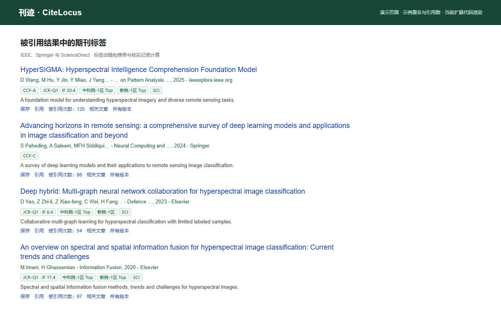
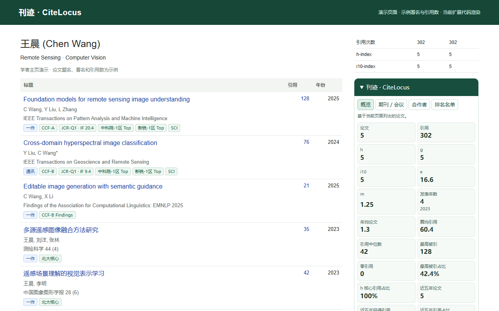
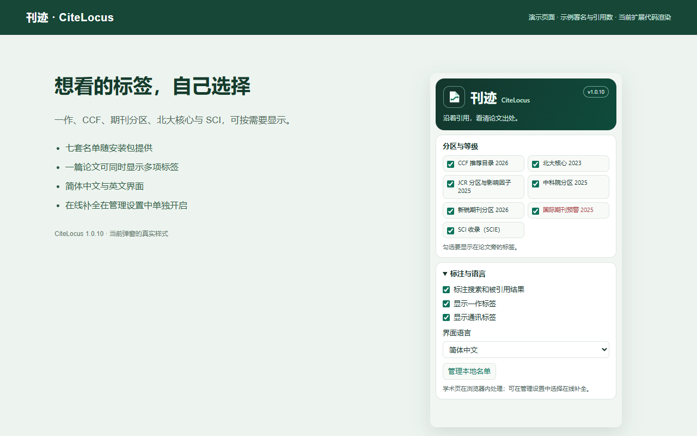

# 安装与使用

从仓库下载源码并解压，在 Chrome 扩展页加载 `extension/`。不需要安装 Node.js 或构建前端即可使用扩展。

首次打开 Google 学术页面时，阅读刊迹说明并选择“同意并启用”。选择“暂不启用”会保持暂停，之后可点击页面角落的刊迹按钮再次查看说明。

工具栏弹窗保留当前的分区与等级布局。可独立开关七类标签，展开“标注与语言”切换一作、通讯、搜索结果标注及语言。

在线补全的入口是“标注与语言 → 管理本地名单”。先阅读该设置旁的说明，再开启独立开关。只对无法确认的条目查询公开元数据，关闭后停止后续请求并取消仍在等待网络响应的请求。本地核实记录仍可匹配。

姓名识别默认从当前学者主页读取。遇到多种署名，可在刊迹面板的署名字段填写中英文别名，以 `|` 分隔；清空可恢复自动匹配。同缩写无法区分时会保留未匹配，通讯仅根据署名星号判断。

标签以所用榜单版本为准。SCI 标签只表示明确的 SCIE 收录匹配，不根据 IEEE、Springer 等出版商名称推断。

统计只覆盖当前页面展示的论文。“显示更多”后会自动更新；不同主会和分轨的统计口径分开。

## 七套内置榜单

| 名单 | 版本 | 条目 |
|---|---|---:|
| CCF | 2026 | 676 |
| 北大核心 | 2023 | 1,987 |
| JCR 分区与影响因子 | 2025 | 20,337 |
| 中科院分区 | 2025 | 21,772 |
| 新锐期刊分区 | 2026 | 22,298 |
| 国际期刊预警 | 2025 | 5 |
| SCI（SCIE） | JCR 2025 · Web of Science | 9,415 |

## 演示截图

以下图片由当前扩展模块在明确标注演示用途的本地学术页结构上生成，测试适配层提供 Chrome API。姓名、论文署名和引用数为示例，标签由随包榜单实际计算。

## 安装间的数据

商店安装与源码加载可能使用不同扩展 ID，浏览器会分别保存数据。内置名单会在新安装初始化，用户修改的名单、偏好和署名别名需按需要重新导入或设置。卸载不会删除你原有的文件或学术账号。
